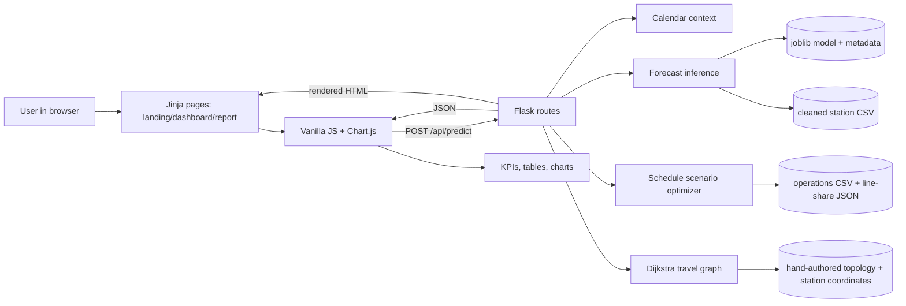
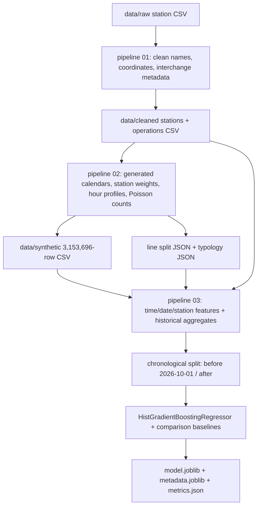

# MetroInsights — Project Analysis for Interview Preparation

**Stage 1 repository analysis**  
**Inspected:** 14 October 2026  
**Repository:** `dmrc_footfall_predictor`, branch `main`, HEAD `4405d16` (`Fixed overnight bug`)  
**Scope:** tracked source, documentation, configuration, and small metadata/model-report files. The generated 130 MB CSVs and virtual environment were not opened or exhaustively inspected.

This report describes the current repository implementation. It does not generate the interview-study PDFs; those are for a later, separately directed stage.

## 1. Executive project summary

MetroInsights is a Flask web application for exploring **simulated Delhi Metro demand forecasts and service-planning scenarios**. A user selects a station, date, time, and optionally a line. The backend predicts hourly station demand using a saved scikit-learn model, distributes estimated demand over lines at interchange stations, applies a rule-based headway/frequency calculator, and returns a demand profile, service KPIs, line allocation, and estimated network travel times.

The application is useful as a **prototype and technical demonstration** of a transit-planning workflow. It is not currently a passenger-counting or operational dispatch system. The supplied footfall dataset is generated by this repository; the repository has no observed station-by-hour passenger counts, AFC feed, live service feed, or verified timetable. The model's reported scores therefore measure fit to generated scenarios, not predictive accuracy against real DMRC ridership. Operational capacities, headways, fleet sizes, transfer penalties, and station sequence data also need external verification before operational use.

### Plain-English request flow

The browser sends a selected station and time to Flask. Flask builds calendar features, asks the saved model for an estimate, applies a scheduling rule set, and returns JSON. The page updates its KPIs and charts. A separate graph calculation estimates the shortest travel time to each station represented in the topology.

## 2. Verified repository structure

The repository has 45 tracked files (current checkout). Main files and directories:

```text
run.py                              Local Flask entry point
Procfile                            Gunicorn web-service command
requirements.txt                    Python dependencies
read.md                             Project overview, setup, and deployment notes
DATA_AUDIT.md                       Data provenance and readiness audit
app/
  __init__.py                       Flask app construction
  routes.py                         HTML and JSON routes, request orchestration
  forecasting.py                    Model loading and forecast inference
  scheduling_optimizer.py            Demand-to-headway simulation rules
  calendar_context.py                Date, workday, and occasion context
  operating_hours.py                 Shared 05:00–23:30 modeled service window
  network_topology.py                Hand-authored ordered line/transfer map
  travel_graph.py                    Graph creation and Dijkstra shortest times
  templates/{landing,index,result}.html
  static/{css,js,animation.gif,dmrc_logo.png}
pipeline/
  01_audit_and_clean_data.py          Station metadata cleaning and ops CSV creation
  02_generate_calibrated_dataset.py   Synthetic scenarios and line-share generation
  03_train_and_evaluate_forecaster.py Feature preparation, training, evaluation, artifacts
data/raw/                             Small station and line CSV inputs
data/cleaned/                         Derived station, operation, and typology inputs
data/synthetic/                       Generated line-distribution JSON; large CSV ignored
models/                               Serialized model, metadata, and metrics JSON
csvFiles/                             Legacy-compatible CSV inputs/outputs
csvFilesGenerator/                    Older generation scripts and run note
```

There is no `README.md`; the overview is `read.md`. No database, notebooks, Dockerfile, CI workflow, lockfile, automated test suite, or test configuration is tracked. A local `venv/` exists but is ignored and is not part of the deployable repository. `.vscode/` contains editor configuration.

## 3. Purpose, intended users, and use cases

- **Implemented user experience:** a station/date/time scenario dashboard with demand, suggested headway/frequency, utilization, wait-time estimate, line breakdown, and destination travel-time estimates.
- **Likely intended audience (inferred):** project reviewers, students, or planners exploring scenario assumptions. There is no role system, login, or operational-control workflow.
- **Inputs:** station, date, time, and optional corridor/line selection. The API accepts JSON or query parameters; the legacy result route accepts form data.
- **Processing:** calendar classification, model inference, minute interpolation, line-share allocation, heuristic schedule calculation, and shortest-time graph search.
- **Outputs:** HTML landing/dashboard/report pages; `/api/predict` returns JSON with forecast, service recommendation, date context, profile, and travel-time results.
- **Practical demo use:** compare how generated demand curves and rule-based service scenarios change by station, time, date type, and line.

“Real-time” in some comments or presentation copy means on-demand calculation after a user changes controls. The source does not show live passenger, train-location, or timetable integration.

## 4. Verified technology inventory

Versions below are declared by the repository, not independently installed/runtime-verified. Sources: `requirements.txt`, `Procfile`, template script tags.

| Technology | Declared version / use | Source files | Trade-offs and alternatives |
|---|---|---|---|
| Python | Runtime version is not pinned; app and pipelines are Python | `run.py`, `app/`, `pipeline/` | Straightforward data/ML ecosystem; add a supported Python version declaration for reproducible hosting. |
| Flask | `3.1.3`; routes and HTML rendering | `app/__init__.py`, `app/routes.py` | Small synchronous web framework; alternatives include Django or FastAPI if admin/auth or typed async APIs become requirements. |
| pandas | `3.0.5`; CSV ingestion, tables, features, graph metadata | pipelines and app modules | Convenient tabular operations; large in-memory generation/training is resource-heavy. |
| NumPy | `2.5.2`; feature encodings and seeded random draws | `pipeline/02...`, `pipeline/03...`, `app/forecasting.py` | Vector math and RNG; alternative generators could be needed for calibrated simulation. |
| scikit-learn | `>=1.5.0`; `HistGradientBoostingRegressor`, Ridge, metrics | `pipeline/03...`, saved `.joblib` artifacts | Tabular regression and preprocessing; version range is broad for serialized estimator compatibility. |
| joblib | `>=1.4.0`; model/metadata serialization | `app/forecasting.py`, training pipeline | Simple Python artifact persistence; artifacts should be loaded only from trusted sources and versioned with their environment. |
| SciPy | `>=1.10.0`; declared dependency; no direct import found in application source | `requirements.txt` | May be transitive/unused directly; verify whether it is needed. |
| Gunicorn | Listed without a pinned version; production WSGI server command | `Procfile` | Fits a Flask WSGI app; should be pinned for predictable deployment. |
| Jinja2 / HTML / CSS / browser JavaScript | Jinja2 `3.1.6`; native frontend and responsive themes | `app/templates/`, `app/static/` | No frontend build chain; vanilla JS is simple but client/server contracts are manually maintained. |
| Chart.js | CDN reference `4.4.1`; interactive line and doughnut charts | `index.html`, `result.html`, `dashboard.js`, `theme.js` | Quick chart rendering; CDN availability and network access are runtime dependencies. |

**No database is used.** The runtime reads CSV/JSON metadata and scikit-learn/joblib artifacts. No secrets or environment-variable manifest is present; `run.py` reads `PORT` and `FLASK_DEBUG` with defaults.

## 5. Architecture diagram



There is one Flask process/application, no ORM or database tier, and no message queue. Model artifacts and graph/metadata inputs are loaded or built in-process at startup. `app/__init__.py` creates the Flask object and imports routes; `routes.py` loads station data and builds the travel graph at module import. `forecasting.py` loads the model and metadata at module import.

## 6. End-to-end flows

### Training and artifact flow



1. `pipeline/01_audit_and_clean_data.py` trims suffix artifacts, patches a short explicit coordinate list, joins hand-authored interchange definitions, and writes cleaned/legacy CSVs. It also writes operations assumptions from constants.
2. `pipeline/02_generate_calibrated_dataset.py` generates 728 dates × 228 stations × 19 hourly buckets = 3,153,696 synthetic records with seed 42. Station weights, hour curves, day types, typologies, months, and event factors are authored in code. A Poisson draw produces each integer count. It writes both `data/synthetic/dmrc_calibrated_footfall.csv` and the legacy duplicate under `csvFiles/`.
3. `pipeline/03_train_and_evaluate_forecaster.py` creates time/calendar encodings and integer station/line/category IDs, computes historical aggregates, splits by date, trains/evaluates models, and saves model, metadata, and metrics.

### Representative dashboard request

1. Browser controls in `index.html` collect station/date/time/line. `dashboard.js` POSTs those values to `/api/predict`.
2. `routes.py` validates date/time syntax, calculates Delhi calendar context, and determines whether the selected minute is inside the modeled service window.
3. For open times, `forecasting.py` builds a 23-column feature row, predicts hourly demand, linearly interpolates the minute estimate, and constructs a 05:00–23:00 daily curve. Closed times return zero selected-time demand.
4. `scheduling_optimizer.py` distributes interchange demand using synthetic shares, then calculates baseline and recommended frequencies under configured scenario constraints. Closed times are represented as zero demand and service closed.
5. `travel_graph.py` runs Dijkstra from all line-nodes belonging to the origin station and keeps the fastest result per destination.
6. The JSON response is rendered into KPI elements, line table/doughnut chart, daily demand chart, and travel-time table.

## 7. Features and workflows

### Implemented

- Landing page with an example station curve and scroll-linked decorative train (`landing.html`, `landing.js`).
- Dashboard station selection, station/line context, date-aware occasion/workday note, line filtering, demand curve, summary KPIs, interchange allocation, and travel-time search (`index.html`, `dashboard.js`).
- Light/dark theme setting stored in browser `localStorage` (`theme.js`).
- Forecast model inference with minute interpolation and a 19-point 05:00–23:00 curve (`forecasting.py`).
- Date-specific categories and listed occasions; weekday is computed from the chosen date (`calendar_context.py`).
- Configurable frequency/capacity simulation with explanatory text (`scheduling_optimizer.py`).
- Topology-aware shortest-time estimate (`travel_graph.py`).
- Synchronous report rendering route (`/get_footfall`) and JSON endpoints (`/api/predict`, `/api/stations`, `/api/model_metrics`).
- Selected-time closure handling for 23:30 through 04:59 was added in HEAD `4405d16` and is reflected in `operating_hours.py`, the forecast/scheduling paths, and frontend text.

### Documented intent, not verified capability

- Documentation describes topology/operational parameters as “realistic,” “verified,” or “official” in some comments and prose. `DATA_AUDIT.md` explicitly qualifies these inputs as hand-authored or unverified; the repository itself does not contain row-level citations proving operational values.
- The interface mentions service planning for operations controllers, but it does not connect to dispatch systems and has no live operational state.
- The `calendar_context` source labels some holiday entries, but future festival effects remain assumptions; this is not a live calendar integration.

### Not implemented / planned prerequisites

- Observed station/time ridership, entries/exits, OD/transfer matrices, load-on-train observations, or real-time AFC data.
- Verified current headways, service hours per line/day, train assignments, signaling rules, depot/turnaround constraints, and official current network topology.
- User login/roles, persistence of user scenarios, database, exports, and model monitoring.

## 8. Data and model analysis

### Data assets

The repository's `DATA_AUDIT.md` reports:

| Asset | Role | Verified scope and limitation |
|---|---|---|
| `data/raw/DELHI_METRO_DATA.csv` | Station/line/coordinate seed | 228 rows; no passenger counts or dates. Source/license/retrieval details are not in the repository. |
| `data/raw/metro_lines.csv` | Legacy line/capacity seed | 9 data rows; its values are not traceably validated in this project. |
| `data/cleaned/stations_cleaned.csv` | Runtime station directory and graph coordinate input | Derived from raw records plus authored topology; “cleaned” does not mean independently verified. |
| `data/cleaned/metro_line_operations.csv` | Schedule simulation parameters | Contains capacity, comfort capacity, signal/policy bounds, baseline headways, fleet, and turnaround. Treat as project assumptions until sourced. |
| `data/cleaned/station_typologies.json` | Generated categorical station labels | Project-assigned categories; not an official classification. |
| `data/synthetic/line_distribution_model.json` | Per-interchange share allocation | Proportions are calculated from project throughput weights and route lengths, not measured passenger transfers. |
| `data/synthetic/dmrc_calibrated_footfall.csv` | Training/evaluation generator output | 3,153,696 generated records over 728 days, 228 stations, 19 hours. Every footfall target is synthetic. |

The large generated CSV exists in this local checkout at roughly 130 MiB, but `.gitignore` excludes it and `git ls-files` confirms it is not tracked. The generator also writes the legacy copy. **Serving the app does not read either large CSV**: runtime inference reads the serialized model/metadata and small station/operations/line-share files. Regenerating or retraining does require the synthetic CSV (pipeline 02 can recreate it). This distinction matters for deployment and reproducibility.

### Generator and feature construction

The generator distributes a code-authored system-level daily target across stations using line weights, interchange multiplier, and a named-hub multiplier. It applies authored weekday/Saturday/Sunday hour profiles, monthly/event factors, selected station-type modifiers, then samples `Poisson(expected_hourly)`. The code does not calibrate these station-hour values from actual observed station-level counts.

`prepare_annual_data()` builds 23 features: date parts; weekend, workday, holiday and event class; sine/cosine encodings for hour, weekday, and month; station/line/typology indices; interchange/line-count values; and station, station-hour-weekday, and station-month historical means. For training rows, the latter are constructed from earlier rows/dates; for holdout rows, training-period aggregates are used. This is a meaningful attempt to avoid using a row's own target or future observations in historical features.

### Model and evaluation

- Model: `HistGradientBoostingRegressor(max_iter=250, learning_rate=0.06, max_depth=9, min_samples_leaf=25, l2_regularization=0.05, random_state=42)` (`pipeline/03...`).
- Baselines: station mean, station/day-of-week/hour historical mean, and Ridge regression.
- Split: train dates before 2026-10-01; test dates 2026-10-01 through 2027-01-03, according to the committed metrics file.
- Reported synthetic holdout metrics for the boosting model: MAE 27.90, RMSE 54.82, R² 0.9947, MAPE 5.16% (MAPE is calculated only over non-zero targets).
- Comparison metrics appear in `models/evaluation_metrics.json`; the best score only demonstrates recovery of the synthetic patterns. The test set is generated by the same authored mechanism as training, so it is not evidence of real-world accuracy.
- Artifacts `footfall_forecaster.joblib` and `forecaster_metadata.joblib` are committed, so ordinary application startup does not retrain.

### Inference details

`predict_hourly_footfall()` obtains station and feature indices from metadata, derives date/calendar/time encodings, fills the feature row in metadata's saved column order, calls `.predict()`, and clamps the result at zero. Minute interpolation linearly blends the current and next hourly predictions. `predict_station_full_day_profile()` predicts each integer hour from 05 through 23 and computes line curves using the interchange shares.

**Important limitation:** the final profile has an hourly 23:00 point and no half-hour bucket. The selected-time service gate closes at 23:30, but the daily curve and synthetic target generator still model a full 23:00 hour. Avoid interpreting that last bucket as an exact minute-level operating count.

## 9. Scheduling and capacity logic

`optimize_line_schedule()` is a deterministic rules/assumption calculator, not a learned optimizer or timetable solver:

1. Read nominal/comfort capacity, minimum signaling headway, maximum policy headway, fleet size, and turnaround minutes from `metro_line_operations.csv`.
2. Bound maximum frequency by `min(floor(fleet_size × 60 / turnaround), floor(60 / min_signal_headway))`; derive minimum frequency from maximum policy headway.
3. Classify weekday peak hours as 08:00–10:59 and 17:00–20:59 in integer-hour logic; use baseline peak or off-peak headway (with taper factors at 05, 06, 22, 23).
4. Estimate per-train boarding clearance as comfort capacity times `1 - through_load_factor`, using 65% through-load in peak and 40% otherwise, with a 250-rider floor.
5. Compare projected line demand to baseline clearance capacity, select increase/maintain/decrease behavior, clamp to constraints, and round to a list of practical headways.
6. Recompute capacity utilization, shortfall, `headway / 2` expected wait, fleet sets `ceil(turnaround / headway)`, badge, and narrative.

For interchanges, demand is multiplied by JSON line shares; there is no observed boarding/transfer allocation. Capacity utilization is projected line demand divided by the modeled **boarding-clearance capacity**, not actual train occupancy. The system lacks onboard passenger load state, arrivals/exits by origin/destination, train position, and live train capacity. Thus it cannot calculate the exact load already on a train as it reaches a station. “Comfortable Capacity” or “crowding” outputs are simulation labels based on these assumptions.

**Potential correctness gaps:** peak status is hourly, so the implementation marks all of hour 20 as peak even though its docstring says the peak ends at 20:30. The schedule optimizer currently calculates a selected-line/current-station scenario and does not optimize a full time-dependent timetable or coordinate trains on a corridor.

## 10. Network graph and travel-time algorithm

`network_topology.py` contains ordered stop lists for 11 project-defined lines/branches and 25 interchange definitions, with aliases for naming differences. It intentionally reflects an older/static coverage and omits some non-DMRC/other network branches per comments.

`build_graph()` maps topology names to station CSV rows, creates nodes of `(station, line)`, and connects adjacent stops. If coordinates are usable, edge weight is `haversine_km / 32 km/h × 60`, floored at one minute; outlier segments over eight minutes and missing/repeated placeholder coordinates use a 2.5-minute fallback. At a listed interchange, line-nodes are linked with a fixed five-minute penalty. `shortest_times_from()` is multi-source Dijkstra: it starts on every represented line at the origin, uses a min-heap, and returns the minimum distance per destination station.

This is more topology-aware than connecting every station by straight-line distance. It still produces an **estimated travel time**, not a path itinerary: there is no predecessor/path reconstruction, timetable waits, direction/time-of-day service, transfer-specific penalty, platform walking distance, disruptions, or verified edge schedule. The same calculation is performed per prediction request and is not cached.

## 11. APIs, frontend, storage, and execution paths

| Route | Behavior |
|---|---|
| `GET /` | Landing page plus sample Rajiv Chowk curve. |
| `GET /dashboard` | Renders station/date/time controls and page shell. |
| `POST /get_footfall` | Legacy synchronous scenario report. |
| `GET/POST /api/predict` | Main JSON scenario endpoint; runs forecast, optimizer, graph routing. |
| `GET /api/stations` | Station metadata JSON. |
| `GET /api/model_metrics` | Stored model-comparison metrics plus synthetic-data provenance flags. |

The browser uses vanilla JS, `fetch`, DOM updates, and Chart.js. Dashboard charts show the predicted operating-hours curve and historical synthetic training-period mean; line curves are extra datasets at interchanges. The table is searchable and filtered in the browser. There is no database or user-scenario persistence.

`run.py` runs Flask on `0.0.0.0`, default port 5000; `PORT` and `FLASK_DEBUG` can override. `Procfile` starts `gunicorn run:app`. Deployment instructions exist in `read.md`, but no Render-specific YAML, Docker config, CI, or deployment health-check configuration is tracked.

## 12. Important file and function map

| File / functions | Responsibility / interview importance |
|---|---|
| `app/__init__.py:3-6`, `run.py:1-8` | Flask construction/import and local process entry. Discuss import-time work and WSGI startup. |
| `app/routes.py:49-89` | Date/time parsing, service-hour decision, percentile-like demand band from daily profile. |
| `app/routes.py:92-139` | Landing/dashboard rendering, station metadata transfer to browser. |
| `app/routes.py:142-231` | Form-driven HTML scenario path. |
| `app/routes.py:234-399` | JSON request path, aggregations, API response shape, transit graph results. |
| `app/forecasting.py:34-53` | Station metadata lookup and fallback behavior. |
| `app/forecasting.py:56-130` | Feature-row construction, saved estimator inference, minute interpolation. |
| `app/forecasting.py:133-188` | Full operating-hour profile, line splits, daily peak/total. |
| `pipeline/01_audit_and_clean_data.py:201-278` | Cleaning and operations CSV generation; understand authored values versus sourced data. |
| `pipeline/02_generate_calibrated_dataset.py:187-300` | Interchange weights, station weights, date/hour simulation, output generation. |
| `pipeline/03_train_and_evaluate_forecaster.py:48-194` | Feature engineering, chronology, historical aggregates, metadata. |
| `pipeline/03_train_and_evaluate_forecaster.py:197-290` | Metrics and estimator fitting/artifact persistence. |
| `app/scheduling_optimizer.py:38-78` | Peak rule, line distribution lookup, headway rounding. |
| `app/scheduling_optimizer.py:81-249` | Per-line rules, constraints, risk labels, calculations, explanation. |
| `app/scheduling_optimizer.py:252-306` | Interchange-level demand allocation and schedule bundle. |
| `app/network_topology.py:21-169` | Ordered line sequences, interchanges, aliases and fixed time assumptions. |
| `app/travel_graph.py:29-167` | Coordinate parsing, edge weighting, graph build, Dijkstra. |
| `app/calendar_context.py:26-111` | Fixed occasion catalog and workday/holiday feature output. |
| `app/static/js/dashboard.js:154-201` | API request, stale-request guard, loading/error states. |
| `app/static/js/dashboard.js:203-313` | KPI, chart, table, and travel-time rendering. |
| `app/templates/index.html`, `landing.html`, `result.html` | User-facing controls and Jinja layouts. |

## 13. Testing, correctness, and quality review

### Verified strengths

- Pipeline is divided into cleaning, generation, and training/evaluation stages.
- Chronological holdout is more appropriate for date-driven forecasting than a random row split.
- Training historical features exclude the current training row and use training-period aggregates for later test rows.
- The UI and metrics label the estimator/data as synthetic in several visible places; `DATA_AUDIT.md` is unusually candid about limits.
- Runtime artifacts are shipped, so serving need not perform a multi-million-row retrain.
- The travel graph models line-specific nodes and charges a transfer penalty rather than treating shared station names as free transfers.
- Inputs for date and time are parsed with errors returned to the user; the selected-time closure is explicitly modeled.

### Verified limitations

- No tests or test runner are tracked. No automated API, model, data-quality, or edge-case checks were found.
- There is no empirical validation against observed ridership or an official current timetable.
- Many operation parameters and line-share weights are code-authored and lack traceable per-value references.
- The network topology and raw station data are a static snapshot; no current-feed refresh workflow is implemented.
- No lockfile or pinned Python runtime; several key ML dependencies use open lower bounds, which weakens artifact reproducibility.
- Generated 130 MiB data outputs are ignored/untracked. A fresh clone cannot rerun training until it regenerates the synthetic dataset.
- Generator builds a Python list containing millions of tuples before writing CSV and writes the output twice (synthetic and legacy), with substantial time, memory, and disk implications.
- Runtime prediction does not use the 130 MiB CSV; relying on that fact is important when configuring a hosted service.
- Routes accept a station string without a clear whitelist check. Unknown-station behavior can fall through metadata defaults, and the optimizer's empty-line case is not obviously safe. Treat this as an input-validation risk to investigate, not as an exploited vulnerability.
- The API has no authentication/authorization or rate limiting. That is acceptable for a public demonstration but not an operations-control service.
- Frontend table rows are built with `innerHTML`; current line names/colors originate from repository data, but the pattern deserves care if external/user-supplied names ever enter those strings.
- Calendar features cover specifically listed occasions, not arbitrary events; future entries and impact multipliers remain scenario assumptions.
- The model's learned historical averages are from synthetic training targets, even though they are generated causally within the training split.
- Current model artifacts are loaded with joblib at import. The package versions used to create those artifacts should be kept compatible with the runtime.
- `calendar_context` says a listed event can be distinguished from a confirmed office closure, but `pipeline/03` constructs `IsWorkday` as weekday and not a public holiday; this is intentional in broad terms, yet holiday/occasion features can still affect generated outcomes differently from actual service calendars.
- Result claims such as passenger wait `headway / 2` assume random passenger arrivals and regular service. They do not incorporate timetable-aware arrivals.

### Potential improvements (not implemented in this analysis)

1. Obtain licensed, timestamped observed entries/exits, transfer/OD data, actual timetables, fleet and operating constraints; log source, date, license, and transformations.
2. Validate by future-time and station holdout against observed data, compare robust baselines, report confidence intervals and station/period slices, and keep synthetic metrics clearly separated.
3. Replace manually maintained topology and timetable assumptions with a versioned, audited feed (e.g., reviewed GTFS/static source); retain a documented provenance per row.
4. Add contract/unit/integration tests for time boundaries, date features, model schema, station validation, closed service, interpolation, aggregation, and graph connectivity.
5. Pin the Python runtime and all artifact-sensitive dependencies; add a reproducible build/deploy configuration and health check.
6. Make synthetic data generation streaming/chunked and avoid duplicate outputs unless backward compatibility explicitly requires them.
7. Validate requested station/line values, handle unavailable graph coverage explicitly, and move toward typed request/response schemas.
8. Separate model artifact metadata/versioning from app code; monitor model/data versions once observed-data inference exists.
9. For actual passenger capacity at a station, model inbound train load and exits before calculating remaining capacity plus boarding. Current station-hour demand divided by theoretical clearance capacity is a different metric.

## 14. Security, privacy, performance, and operations

- **Security:** no credentials or database secrets are present in the inspected source. Authentication, authorization, CSRF strategy, and rate limiting are absent. This repository currently exposes scenario estimates, not privileged live controls. Validate station/line inputs and keep user-derived strings out of HTML interpolation if the source of those strings expands.
- **Privacy:** no personal or passenger-level records are present in the tracked dataset descriptions. Counts are synthetic aggregates.
- **Performance:** estimator and metadata are loaded once per worker; graph is rebuilt at application import. Every prediction evaluates the selected hour and 19 points for the chart, and recomputes Dijkstra; a small graph is likely manageable but no benchmark is provided. Multiple Gunicorn workers each load a model and graph copy.
- **Deployment:** `Procfile` is sufficient for a conventional WSGI host if all small runtime dependencies/artifacts are included. Free hosting may sleep; no persistent-disk assumption appears in runtime code. The 130 MiB ignored training CSV is not needed to serve requests, but should not be assumed present for retraining on the host.
- **Reproducibility:** pipeline seed is explicit, but package/runtime versions and source provenance are incomplete. Re-running pipeline 01 or 02 overwrites generated/cleaned artifacts and may produce data/model versions not matching the committed model unless pipeline 03 is also run.

## 15. Missing evidence and unknowns

- Original authoritative source and license for the raw station/coordinate file.
- Current official station coverage and whether all 228 records correspond to the intended network snapshot.
- Supporting evidence for each capacity, fleet, headway, signaling, turnaround, transfer, speed, and station coordinate assumption.
- Whether station-level synthetic daily allocations preserve a consistent network-wide sum after station-type multipliers (the multipliers are applied after normalized weights and are not visibly renormalized per day).
- Actual deployed Render settings, current production environment, memory/runtime measurements, and whether the public service is healthy. Repository configuration alone cannot verify these.
- Model artifact training environment and full dependency versions at artifact-creation time.
- Availability and completeness of broader project history or user research outside the repository.

## 16. Honest interview framing

**Suggested project introduction:** “I built a Flask-based Delhi Metro demand and service-planning simulation. It combines a synthetic-data forecasting pipeline, a saved scikit-learn model, rule-based headway scenarios, interchange demand allocation, and a topology-aware shortest-time graph. I made the dashboard label outputs as simulations because we do not yet have observed station-level passenger counts or verified operational constraints.”

Be prepared to explain that the strong R² is a synthetic holdout score, not proof of real-world performance. A good discussion is why temporal validation, feature history, explicit assumptions, provenance, and a real observed-data evaluation are necessary before operational decisions. Do not claim live/real-time passenger counts, verified DMRC schedules, real measured line shares, or 226 official destinations unless independently validated.

### Likely interview questions

1. Why did you choose a chronological split? What would a station-held-out test measure?
2. What does MAE/RMSE/R² mean here, and why can the metrics not be presented as real-world accuracy?
3. How do you prevent historical aggregate features from leaking the target or future data?
4. Why encode cyclical time features with sine/cosine, and what station IDs imply about generalization to new stations?
5. Walk through one request from browser controls to model inference, schedule calculation, and rendered chart.
6. How is the recommended headway bounded by fleet and signaling assumptions? What is omitted from the capacity model?
7. How does a line-expanded graph let you model transfers? What exactly does Dijkstra return?
8. What would change to calculate the passenger load remaining on a specific arriving train?
9. What happens when the data CSV is missing in deployment? Which CSVs are runtime-critical and which are training-only?
10. Which tests and real datasets would you add first, and how would you prove the system is safe enough for real operational use?

## 17. Proposed staged study-material roadmap

The following is a draft roadmap based on the repository; the user will provide Stage 2 phase requirements later. No PDFs are generated in this Stage 1 report.

1. **Project/product walkthrough:** user problem, honest scope, workflows, interview introduction, and demo script.
2. **Python/Flask architecture:** app boot, routes, request/response contract, templates, frontend-to-backend flow, and error handling.
3. **Data pipeline and provenance:** raw vs cleaned vs synthetic assets, schema, generated-data math, CSV lifecycle, and reproducibility.
4. **Forecasting/model lifecycle:** 23 features, encodings, history aggregates, chronological holdout, metrics, artifact inference, and model limitations.
5. **Transit service simulation:** line allocation, capacity-utilization definition, headway constraints, wait assumptions, and improvements for onboard load.
6. **Graph algorithms and network modeling:** ordered stops, expanded nodes, edge-weight assumptions, interchange links, Dijkstra intuition/complexity, and missing-route cases.
7. **Deployment, testing, and engineering review:** Gunicorn, dependency/artifact handling, runtime versus training data, test plan, security/performance, and redesign questions.
8. **Interview practice pack:** code walkthrough, technical follow-ups, debugging cases, system-design prompts, trade-off defense, and truthful limitations.

Each later phase should cite concrete repository files and distinguish verified implementation, limitation, risk, unknown, and proposed improvement. PDF generation should follow the requested phase-by-phase workflow after the phase instructions are supplied.
